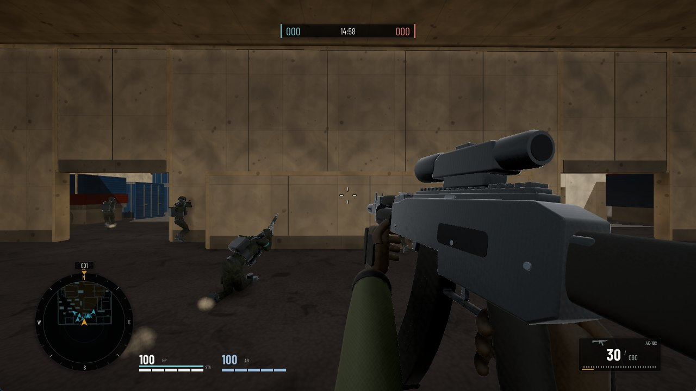

# Shooter

**An offline military FPS whose maps, weapons and gear are generated from code.**

[](https://maks417.github.io/shooter/)

[**Website**](https://maks417.github.io/shooter/) · [**Download v0.3.28 for Windows**](https://github.com/Maks417/shooter/releases/tag/v0.3.28) · [Docs](docs/index.md)

Shooter is a Unity 6 URP first-person shooter. Maps, weapons, soldier gear and materials come from deterministic numeric recipes; soldier bodies, their animation clips and the fire and smoke flipbooks are licensed CC0 art (see [License](#license)). You play Team Deathmatch against local allied and enemy bots, with no account, network or server.

> **Status: playtest build.** v0.3.28 is playable but still in development. The [release notes](https://github.com/Maks417/shooter/releases/tag/v0.3.28) list known issues.

## Features

- **Procedural world:** buildings, terrain, weapons and soldier gear are generated by seeded C# generators. The only authored art is the pinned CC0 soldier and effects packs.
- **Team Deathmatch vs bots:** 5v5, 8v8, 10v10 or 15v15. A match ends at 150 kills or after 15 minutes.
- **Three maps:** Training Compound (Old Town), Depot Yard (Harbour) and Oil Depot.
- **Fixed 60 Hz simulation:** movement, combat, hit volumes and AI are authoritative and independent of rendering quality.
- **Windows installer:** per-user, upgrades in place and keeps your settings and key bindings.

## Controls

| Action | Key |
|---|---|
| Move / look | WASD / mouse |
| Fire / aim | LMB / RMB |
| Reload | R |
| Rifle / pistol | 1 / 2 |
| Sprint / crouch / jump | Left Shift / Left Ctrl / Space |
| Slide (while sprinting) | Left Shift + F |
| Scoreboard / pause | Tab / Esc |

Every binding can be changed in Settings.

## Building from source

The toolchain is pinned. Use Unity **6000.3.28f1** (rev `8f082d2fe476`, URP 17.3.0) and **.NET SDK 10.0.301**, as recorded in [`toolchain-lock.json`](toolchain-lock.json) and [`global.json`](global.json). Run commands from the repo root in PowerShell 7.

Pure test lanes run without Unity:

```powershell
./Tools/Test-All.ps1
```

Unity lanes and builds:

```powershell
./Tools/Configure-Unity.ps1 -EditorPath '<editor>/Editor/Unity.exe'
./Tools/Test-Unity.ps1 -Mode EditMode
./Tools/Deliver.ps1 -ForceContent     # content + client build, smoke, package, installer
```

[`docs/bootstrap-runbook.md`](docs/bootstrap-runbook.md) explains every wrapper.

## Architecture

All C# lives under `UnityProject/Assets/Shooter/`, split into assemblies with strict dependency rules:

- **Contracts / Game.Contracts:** frozen, engine-free IDs, DTOs and ports.
- **Generation:** pure deterministic generators, plus an editor-only content compiler.
- **Simulation:** the fixed 60 Hz authority (motor, combat, pose, AI, match rules).
- **World / Content:** collision, navigation and map packages.
- **Presentation:** a client-only, read-only consumer of simulation snapshots.
- **Bootstrap:** the single composition root.

The pure assemblies also compile outside Unity through matching SDK projects in `Tools/`, so they are unit-tested in plain .NET. See [`docs/architecture.md`](docs/architecture.md) and the [decision log](docs/decisions.md).

## License

The source code is released under the [MIT License](LICENSE). Soldier bodies and animation clips are by Quaternius (CC0), and the fire and smoke flipbooks are Unity Labs' free VFX flipbooks (CC0); every file is pinned in [`Tools/art-sources.json`](Tools/art-sources.json). The bundled Barlow Condensed typeface is under the SIL Open Font License 1.1. The Unity runtime in release builds is under Unity's own terms.
