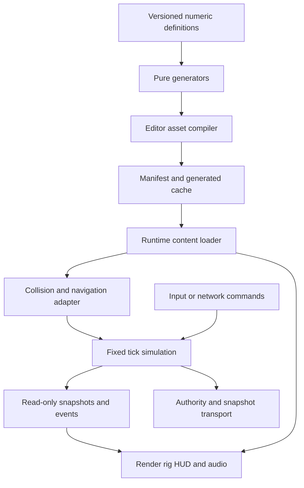

# Architecture

## Current runtime versus intended architecture

The component/flow/lifecycle rules below remain the intended release architecture, not a claim that every adapter is installed. In particular, catalog label hashes and runtime map-plan generation are not verified compiled content delivery; copied Game-v1 snapshots are not the C0 leased publication API. Contract/allocation changes require reviewed compatibility decisions and measured bounds, not silent documentation relaxation.

Read [vision](vision.md), [contracts](contracts.md) and [repo layout](repo-layout.md) before changing boundaries.

Implementation status, reviewed 2026-11-14 at f3d9954: default Bootstrap starts Game/Session/OfflineGameSession with real map colliders, harness authority, TDM reducer and 9/11 initial bots. Floor/box remains an explicit smoke/gallery/benchmark diagnostic. Client composition installs GameShellMenu and ProductSessionView (camera/light/text/input), but no product map/soldier/weapon renderer or audio-device output. Respawn, pause, team sensing/path following and menu-owned lifecycle are incomplete; see the [audit](product-state-audit.md). P05 remains FAIL; no fresh player/server-isolation or hardware acceptance is inferred.

Actual new paths include Game/Contracts/ (frozen Game-v1), Game/Session/, Game/Settings/, Simulation/Session/, Simulation/TeamDeathmatch/, Content/Maps/, World/Runtime/ and Unity collider installation in World/Foundation/CompoundMapRuntime.cs. HarnessActorLifecycle currently wraps the sealed CombatHarnessSimulation; reusable authority retirement is still required, not a completed extraction. [T052–T065](release-remediation-plan.md) complete verified content loading, coherent life/view/event publication, device adapters and shell-owned start/stop. Keep one damage authority, read-only presentation, separate C0/Game result states and no remote dependency on offline launch.

## Components and dependency rules

| Layer / assembly or intended boundary | Owns | May depend on |
|---|---|---|
| Shooter.Contracts | IDs, immutable DTOs, schema constants, ports | BCL only; no UnityEngine |
| Shooter.Game.Contracts (frozen ADR-034) | Map/session/participant/results/settings records and ports; separate Game-v1 freeze | C0 + BCL only; no Unity or remote wire requirement |
| Shooter.Generation.Core | deterministic primitives, recipes, validation | Contracts; pure math adapter |
| Shooter.AssetCompiler.Editor | Unity conversion, LOD/material/nav baking, manifests | Generation.Core, Contracts, Unity Editor |
| Shooter.Content.Runtime | verified cache loading, residency, async handles | Contracts, BCL-only Generation.Core format helpers; future Unity runtime adapter |
| Shooter.Simulation | tick orchestration, motor rules, weapons, damage, AI decisions | Contracts; world-query interfaces |
| Shooter.World.Unity | collision queries, navigation adapter, chunk lifecycle | Simulation, Content.Runtime, Unity |
| Shooter.Presentation | URP rendering, procedural rig, HUD, sound, feedback | Contracts, Content.Runtime, Unity; reads simulation snapshots |
| Shooter.Networking | command/snapshot codec, prediction history, authority adapter | Contracts, Simulation; selected transport |
| Shooter.Bootstrap | composition root, mode selection, tick driver | All runtime assemblies |
| Shooter.Tools / Tests | benchmarks, provenance and verification | Respective public APIs |

Contracts never reference features. Simulation does not reference renderers, animation, Editor APIs or transport packages. Presentation cannot apply damage or mutate authoritative state. Content compiler does not depend on simulation implementation. Server excludes presentation assembly and all graphics cache payloads. Jobs/Burst are optional optimizations after profiling, not a requirement to convert the entire game to ECS.

## Offline frame and simulation loop

Input samples each display frame and accumulates button edges into commands for a 60 Hz fixed simulation clock. Each tick follows [simulation protocol](simulation-protocol.md): validate commands; process action/stance boundaries; move all actors; refresh gameplay hit poses; collect and resolve shots against one immutable pose set; apply queued damage; evaluate match; plan AI commands for next tick; publish leased snapshots/events. Same-tick shots may trade; dead-in-prior-tick shooters cannot fire. Physics queries are serviced by the world adapter on the main thread. Dynamic rigid bodies initially remain cosmetic or server-only; do not let asynchronous physics callbacks establish hit ordering.

Use a kinematic capsule sweep motor with explicit gravity, slopes, steps and overlap recovery. Fixed tick order is stable by entity ID. Dynamic interactions use world-query results from that tick. Rendering interpolates between completed snapshots; the local camera may add visual look and recoil without changing authoritative aim. AI plans produce commands through the same rules as players.

Tick catch-up is capped at four ticks per display frame. Offline pauses and exposes overload telemetry instead of silently dropping combat ticks; network server uses a separate monotonic service loop, logs overload, skips noncritical AI planning and terminates an invalid test session after sustained one-second debt. Network timestamps always refer to simulation ticks, never render frame numbers.

## Loading path

Bootstrap validates build manifest, settings and quality selection. Loader reads collision/navigation plus nearest visual chunk before spawning. Background threads perform bounded file read/decompression/pure generation; Unity object creation and GPU upload run on main thread under an upload budget. A chunk becomes playable only after collision and navigation are installed atomically. Display a loading boundary until then; never expose an empty collision region. Prefetch ahead of player movement and retain adjacent chunks.

## Boundaries and failure modes

- Missing critical collision/weapon/skeleton content: fail session load with diagnostic IDs. No random regeneration in a live match.
- Missing cosmetic LOD: use verified lower-detail cache; missing all visual variants uses a generated diagnostic shape only in developer builds.
- Corrupt cache: reject before deserialization, quarantine and rebuild in editor/tools; shipping clients offer repair/re-download, not arbitrary compilation.
- Generation and GPU work have cancellation, size limits and timeout telemetry. Results enter runtime only through validated manifests.
- Saves/replays record schema, build, generator versions, seed, inputs and relevant authority state. They are diagnostics, not cross-version deterministic gameplay promises.

## Ownership and lifecycle

Only Bootstrap creates services. Constructor injection or explicit factory parameters replace global mutable singletons. Content handles are reference-counted leases; dispose on chunk unload, scene change and cancellation. Simulation owns entity lifetime and emits despawn before views release resources. Unity objects are destroyed on main thread. Pool high-frequency combat events/FX and reuse snapshot buffers after consumer completion. See [contract lifetime rules](contracts.md).

For the new game, the client shell requests validated sessions from Bootstrap; the session loads catalog/content through real map adapters, installs collision/nav before Ready, then feeds local/bot commands into shared authority. Match state and actor snapshots publish coherently at the completed tick. Views read them; settings affect only presentation/input devices. Team match owns scoring, active-time and respawn policy through the actor lifecycle seam, never by mutating HUD data. Final results are an immutable bounded copy that survives map unload. Pause stops offline authority and active-time; stale asynchronous load completions carry an epoch and cannot enter a later session. Details and failure cases live once in [Game-v1](game-session-contracts.md).

## Integration seams

The first vertical harness runs a generated box compound, motor and rifle through fake ports before real art. Every external service (transport, clock, storage, physics, navigation) has an adapter and in-memory test double. A host runs authority and view as separate consumers; avoid code paths that only work when server and local player share objects.

The P02 runtime format-helper dependency and initial codec freeze are recorded in [ADR-018](decisions.md#adr-018--accepted-initial-p02-compiler-format-and-byte-cache-boundary). Runtime never references `Shooter.AssetCompiler.Editor`; the compiler remains Editor/tools-only.
