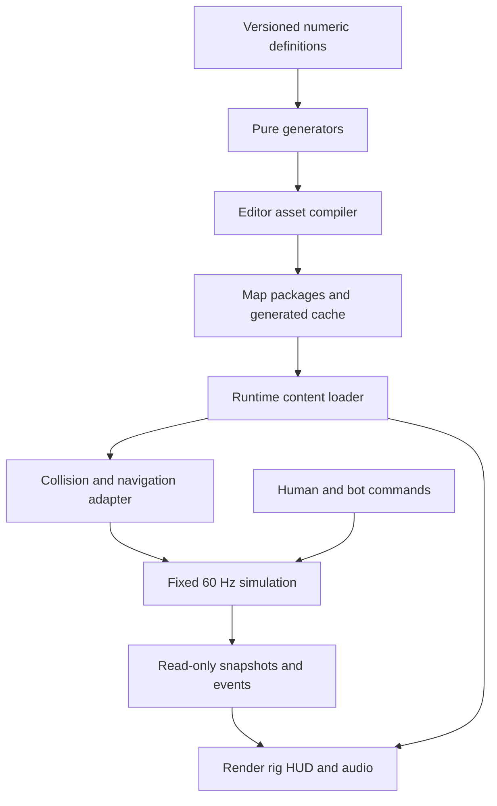

# Architecture and domain model

The product is a single offline client process: one human plus local bots. Networking is parked under [ADR-076](decisions.md#adr-076--accepted-offline-only-scope-and-bounded-local-evidence). Simulation is the single authority and Presentation is a read-only consumer.

Read [contracts](contract-details.md), [Game-v1](game-session-contracts.md) and [repo layout](repo-layout.md) before you change a boundary.

## Assemblies and dependency rules

| Assembly | Owns | May depend on |
|---|---|---|
| Shooter.Contracts (C0, frozen) | IDs, immutable DTOs, schema constants, ports | BCL only |
| Shooter.Game.Contracts (Game-v1, frozen ADR-034) | Map, session, participant, results and settings records and ports | C0, BCL |
| Shooter.VectorMath (`Generation/Core/Math`) | Vector and quaternion math | Contracts |
| Shooter.Generation.Core | Deterministic primitives, recipes, validation | Contracts, VectorMath |
| Shooter.AssetCompiler.Editor | Content compilation and manifests (engine-free, `noEngineReferences`) | Generation.Core, Contracts, Content.Runtime |
| Shooter.Content.Runtime | Verified cache loading, residency, async handles | Contracts, Generation.Core format helpers |
| Shooter.Content.Maps | Map catalog, registry, packages, spawn data | Contracts, Game.Contracts, Generation.Core |
| Shooter.Simulation | Tick orchestration, motor, weapons, damage, AI | Contracts, Game.Contracts, VectorMath |
| Shooter.Game.SessionPorts (`Game/SessionPorts`) | Read-only session view (`IGameSessionView`, `IActorStateReader`), shell control (`IGameSessionControl`), Armory catalog view, local command/view DTOs | Contracts, Game.Contracts |
| Shooter.Game.Session / .Settings | Offline TDM session (`OfflineGameSession` implements the ports), workloads, user settings | Contracts, Game.Contracts (Session also: SessionPorts, Simulation, Content.Maps, World.Runtime) |
| Shooter.World.Runtime | Pure nav compile, revisioned path adapter, streaming scheduler | Contracts, Game.Contracts |
| Shooter.World.Unity (`World/`) | PhysX queries, NavMesh adapter, map runtime | World.Runtime, Generation.Core, Content.Maps, Unity |
| Shooter.Presentation.Model | Unity-free view, HUD, menu, scoreboard, mixer and FX models | Contracts, Game.Contracts, VectorMath |
| Shooter.Presentation | URP rendering, procedural rig, input, audio/FX adapters, session views | Presentation.Model, Contracts, Game.Contracts, Game.SessionPorts, Game.Settings, Content.Maps, Content.Runtime, Generation.Core, VectorMath, Unity |
| Shooter.Networking (parked) | Codec, prediction history, authority adapter; dormant, referenced by no Unity assembly, compiled only under `SHOOTER_NETWORKING` (never defined, so not in players) and tested only by `Tools/Networking.Tests` ([ADR-120](decisions.md#adr-120--accepted-parked-networking-behind-a-define-and-build-once-pure-lanes)) | Contracts, Bootstrap.Core, Simulation |
| Shooter.Bootstrap.Core / .Runtime / .Release / .Client | The only composition root, tick driver, release helpers | Runtime assemblies |
| Shooter.Build.Editor / .FeatureBuild.Editor | `ShooterBuild.*` entry points, native content build, feature compilers | Bootstrap, AssetCompiler.Editor |

Every pure asmdef has a matching `Tools/<Assembly>/Shooter.<Assembly>.csproj`. `Tools/verify_asmdef_graph.py` fails when the two graphs drift.

Boundary rules:
- Contracts never reference features.
- Simulation never references renderers, animation, Editor APIs or transport.
- Presentation cannot apply damage or mutate authority. It reaches the session only through `Shooter.Game.SessionPorts`, and `Tools/verify_asmdef_graph.py` fails if Presentation or Presentation.Model references Game.Session, Simulation or Networking.
- The largest classes are split by concern into partial files (T195): `CombatAiDirector.{Perception,Decision,Navigation,Command}.cs`, `ProductSessionView.{Hud,Audio,CombatFeedback,Camera}.cs` and `ProductShellHost.{Menus,Armory,Settings,Results,Career}.cs`. New work goes into the file for its concern. `Tools/split_partial.py` moves whole members byte-for-byte when a file needs another split.
- Client view modes (product shell, TDM benchmark, galleries, foundation view) are an ordered table in `FoundationClientComposition.Modes`. A new view is one entry, not another branch. The diagnostic views stay in the player, because `Smoke-Gallery.ps1` and `Measure-Rig.ps1` run them from the client build.
- The compiler is Editor/tools-only and never referenced at runtime ([ADR-018](decisions.md#adr-018--accepted-initial-p02-compiler-format-and-byte-cache-boundary)).

## Runtime composition

**Startup.** Bootstrap loads the persisted catalog and map registry through `StaticMapCatalog.TryLoadPublished` ([ADR-038](decisions.md#adr-038--accepted-persisted-release-catalog-t067--b03), ADR-083). It prepares `OfflineGameSession` without starting a match.

**Shell.** `ProductShellHost` owns the flow menu → load → play → pause → results. It binds `UserSettingsEditor` and `ProductClientSettingsApplier` to `shooter-user-settings.json`.

**Loading a map.**
- Map packages carry native NavMesh data published by `Compile-GameContent.ps1 -Native`, through `Bootstrap/Editor/ShooterNativeContentBuild.cs`. The package boundary is [ADR-035](decisions.md#adr-035--accepted-verified-release-map-packages-t055-boundary).
- `UnityNavMeshBakeInstaller` installs the NavMesh at load.
- `RevisionedPathAdapter` reports Complete, Partial or Failed. The packaged-graph fallback is diagnostics-only.

**Views.** `ProductMapView` and `ProductActorPresentation` consume verified visual payloads. Weapon views follow the active slot and combat action events. Combat, footstep and UI events reach the audio mixer.

**Lifecycle.** `CombatHarnessSimulation.RetireActor` and monotonic IDs let `HarnessActorLifecycle` retire lives while `OfflineGameSession` rebinds the human and bots.

**Diagnostics.** The floor/box scene exists only for smoke, gallery and benchmark diagnostics.

## Simulation loop

Input is sampled every display frame. Button edges accumulate into commands for the 60 Hz fixed clock. The tick order is in [simulation protocol](simulation-protocol.md):
1. validate commands;
2. action and stance boundaries;
3. move;
4. refresh hit poses;
5. resolve shots against one immutable pose set;
6. apply damage;
7. evaluate the match;
8. plan AI;
9. publish.

Combat rules within a tick:
- Same-tick shots may trade.
- A shooter who died in an earlier tick cannot fire.
- Physics queries run on the main thread through the world adapter, never from asynchronous callbacks.

The motor is a kinematic capsule sweep with explicit gravity, slopes, steps and overlap recovery, processed in stable entity-ID order. Rendering interpolates between completed snapshots. The camera may add visual look and recoil without changing authoritative aim. Bots produce commands through the same rules as the human. Catch-up is capped at four ticks per frame; overload pauses and is reported, never silently dropped.

The local slide ability ([ADR-039](decisions.md#adr-039--accepted-local-authoritative-sprint-slide-t072)) works like this:
- It travels in a `LocalPlayerCommand` envelope around the frozen C0 `InputCommand`.
- `KinematicMotor` owns its duration, momentum and cooldown.
- Presentation reads `LocalMovementView` only.

## Loading and failure

**Loading.** Collision and navigation install atomically before Ready. Background threads read, decompress and generate within bounds. Unity object creation and GPU upload run on the main thread under an upload budget. Stale async completions carry an epoch and cannot enter a later session.

**Failure handling:**
- **Missing critical collision, weapon or skeleton content:** the load fails with diagnostic IDs. Content is never regenerated in a live match.
- **Corrupt cache:** rejected before deserialization. Shipping clients offer repair; they never compile content.
- **Long-running work:** generation and GPU work have cancellation, size limits and timeout telemetry.

**Ownership.**
- Only Bootstrap creates services, and there are no global mutable singletons.
- Content handles are reference-counted leases.
- Simulation emits a despawn before views release resources.
- Final results are an immutable bounded copy that survives map unload.
- Pause stops authority and active time.

## Domain model

**Game-v1 entities** (details in [Game-v1](game-session-contracts.md)):

| Entity | Responsibility and invariant |
|---|---|
| MapCatalogEntry | Stable MapId → approved recipe, gameplay and visual identities, plus supported sizes |
| SessionRequest | A validated map, mode, team size, seed and rule version; it can never inject recipes or paths |
| Participant | One human or bot on a fixed team; stable name and stats across lives |
| ParticipantLife | Fresh health, ammo and EntityId; death is idempotent; respawn after 180 active ticks |
| TeamMatch | Two scores, active ticks and the 150-kill / 54000-tick limits |
| MatchResults | Immutable final stats, outcome, reason and identities |
| UserSettings | Versioned local sound, video, control and accessibility values; can never change gameplay |

**Core entities** (field shapes in [contracts](contract-details.md), identity in [deterministic format](deterministic-format.md)):

| Entity | Owner and invariant |
|---|---|
| Recipe / GenerationRequest / AssetManifest | Compiler; validated immutable sources and an atomic manifest commit |
| WorldDefinition / Chunk | World; a chunk is playable only once collision and nav are installed |
| MaterialDefinition | Presentation; no combat semantics |
| SkeletonDefinition / SoldierDefinition | Rig joint IDs stable across LODs; Simulation selects the hit profile |
| WeaponDefinition / WeaponState | Simulation; frozen during a match; ammo never negative |
| EntityState / InputCommand / CombatEvent | Authority; finite values, validated commands, deduplicated events |

**Invariants:**
- One authoritative record per nonzero ID, never reused within a match.
- Health stays within 0..max.
- Team filtering runs before damage.
- Render LODs may drop detail but never authoritative hit capsules.
- Units are meters, seconds or ticks, radians internally and m/s.
- Axes are +Y up, +Z forward, +X right.
- Chunk state runs Absent → Requested → Reading → Validating → Installing → Ready → Retiring → Absent, and Faulted is terminal for that request.
