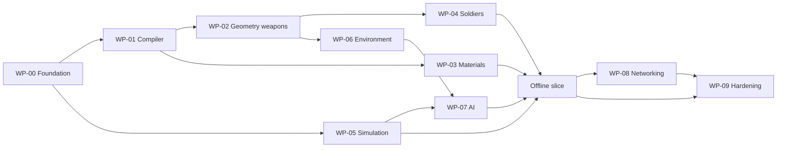

# Work packages and sequenced implementation backlog

All paths are relative to `UnityProject/Assets/Shooter` unless noted. Contracts owned by integrator. Every work package must meet [agent done rules](agent-coordination.md). Estimate after spikes; no speculative hour counts.

Current next work is [T071 playtest and remaining T067 native navigation](next-playable-build.md). A verified `7cd7e81` archive exists; T066 repairs and T068/T069/T070 software are landed. Player/device evidence, native publication/query validation and T062/T065 acceptance remain open. See the [audit](product-state-audit.md) and [launch guide](playtest-guide.md). Original task IDs/requirements, T035 freeze and deferred T025 remain unchanged; historical waivers do not accept new gates.

## Dependency graph

WP-04 rig algorithm spike can start with WP-02 primitive stubs after C0; full soldier cache integration waits for geometry. WP-06 planner can start against fake primitive/physics adapters; final compiler/nav validation waits for real outputs. These are explicit stub-only overlaps, not permission to merge missing dependencies.

## Package contracts

| ID / owner role | Owned paths and output | Dependencies | Acceptance / integration |
|---|---|---|---|
| WP-00 Integrator | Contracts, Bootstrap, Settings, asmdefs, project root locks, benchmark/test scaffolds | None | M0; pure contracts compile, empty scene/server build, B01, CI smoke |
| WP-01 Content engineer | Generation/Core framework, Generation/Editor, Content/Runtime | WP-00 C0 | GenerationRequest→manifest/leases; deterministic fixtures, corruption/cancel tests, cold build |
| WP-02 Geometry engineer | Generation/Core/Geometry and /Weapons | WP-01 API, C0 | Mesh/socket DTOs; rifle/pistol LODs, topology/socket and count tests |
| WP-03 Render engineer | Shaders, Presentation/Rendering, Generation/Core/Materials | WP-01 API | Material planes/URP adapters; seven families, CPU bake, B01 budget |
| WP-04 Character engineer | Generation/Core/Soldiers, Presentation/Rig | WP-02 core; C0 | Skeleton/skin + view poses; M1 risk gate, IK/grip/slide and eight-rig timing |
| WP-05 Simulation engineer | Simulation/Motor, Simulation/Combat, gameplay pose evaluator | WP-00 C0; fake world first | Commands→snapshots/events; M2 rules, motor queries, hit/visual pose contract |
| WP-06 World engineer | Generation/Core/Environment, World/Streaming and /Navigation | WP-01, WP-02, WP-05 query fixtures | World→collision/nav/chunks; four seeds, connectivity, streaming and residency |
| WP-07 AI engineer | Simulation/AI | WP-05, WP-06 nav adapter | Sensing→commands; eight-bot bounded queries, cover/reload/stuck scenarios |
| WP-08 Network engineer | Networking, network-specific tests | WP-05 stable + M4 slice | N1–N3; prediction, codec, lag compensation, impaired-network acceptance |
| WP-09 Integration/performance engineer | Tools, Tests/Performance, CI, Baselines; feature edits coordinated with owner | M0 onward for measurement; M4/M6 for release | Regression gates, visual review, release evidence, optional 60 FPS |

## Execution order and reviewable tasks

| Task | Priority / gate | Depends on | Concrete result and completion check |
|---|---|---|---|
| T001 | P0 / M0 | — | Inspect installed Unity; commit exact editor/package/toolchain lock and licensing/build-agent plan |
| T002 | P0 / M0 | T001 | Contracts C0, IDs/units, DTOs/ports, schemas and boundary fixtures compile outside Unity |
| T003 | P0 / M0 | T002 | asmdefs, composition root, fake world/nav, empty client and headless build pass |
| T004 | P0 / M0 | T003 | Low/Balanced/High assets, B01 timing logger and provenance/docs checks in CI |
| T005 | P0 / M1 | T002 | PCG32 named streams, canonical encoding and hash fixture tests |
| T006 | P0 / M1 | T005 | Compiler DAG, bounded manifest, atomic publication, corruption/cancel/concurrent cache tests |
| T007 | P0 / M1 | T006 | Primitive geometry/UV/normal/LOD generators pass topology tests |
| T008 | P0 / M1 | T006 | CPU procedural material family bake and one cheap URP shader pass B01 |
| T009 | P0 / M1 | T007 | Rifle/pistol recipes and sockets, silhouette review and LOD reports |
| T010 | P0 / M1 | T007,T009 | Soldier anatomy, bind/skin, gait/IK spike with M1 visual/performance evidence |
| T011 | P0 / M2 | T003 | Kinematic motor, input buffering and frame-independent tick tests |
| T012 | P0 / M2 | T011 | Weapon state/damage/reload, muzzle obstruction and duplicate command tests |
| T013 | P0 / M2 | T010,T012 | Shared gameplay hit pose, procedural view arms, ADS/recoil/reload grip checks |
| T014 | P0 / M3 | T007,T011 | Compound planner/collision/nav and four-seed connectivity reports |
| T015 | P0 / M3 | T006,T014 | Runtime leases/visual streaming, budgets, cancellation and 100-traversal test |
| T016 | P0 / M3 | T012,T014 | AI sensing/state/cover/path scheduling, eight-bot scenarios |
| T017 | P1 / M4 | T008,T013,T015,T016 | Objective loop, generated FX/synth audio, HUD/settings and accessibility review |
| T018 | P0 / M4 | T017 | B02/B03 native-720p optimization, 30-minute soak and signed offline gate report |
| T019 | P0 / M5 | T018 | Transport/framework ADR and spike, codec fuzzing and dedicated server/handshake |
| T020 | P0 / M5 | T019 | Local prediction/reconciliation, remote interpolation and impaired two-peer tests |
| T021 | P0 / M6 | T020 | Historical hit queries, fire validation, late join/resync and abuse limits |
| T022 | P0 / M6 | T021 | Four-player/eight-bot B04 soak, loss/jitter/bandwidth and server budget evidence |
| T023 | P1 / M7 | T018,T022 | Reproducible clean release/cold content compile, profile and seed matrix |
| T024 | P2 / M7 | T023 | 60 FPS same-workload experiment, report passed/failed; no baseline relaxation |
| T025 | P3 / later | T023 | Optional projectiles/penetration/eight-player scale via separate ADR and workload |

P0 blocks stated milestone; P1 necessary polish for slice; P2 stretch; P3 outside initial commitment. T011/T012 can run concurrently with T005–T010 against fakes. T008/T009 are independent after compiler. Never defer T004 performance scaffolding until final optimization.

## Handoff example

WP-02 starts on C0/base commit, edits only geometry/weapon generator folders and its tests, takes seed 460072030 and weapon recipe fixtures, returns immutable MeshArtifact/socket DTOs with conservative bounds and triangle reports. It must not modify combat data, URP settings, contract structs or shared generated registry. Its PR attaches cold-regeneration test, socket conformance and silhouette captures. Integrator compiles cache and merges before full soldier/equipment integration.

## Review closure tasks

[T026–T034 task cards](task-supplement.md) assign explicit ownership for C0 details, gameplay/layer matrix, soldier baseline/pose tests, objective, synthesized audio, generated lighting, analytic collapse/optional ragdoll, exact benchmarks and repository runbook. Their milestone dependencies are mandatory; no optional task silently expands the original slice.

## Product remediation tasks

[T052–T065](release-remediation-plan.md) retain original audit repair requirements; their software is substantially committed in 59316d3. [T066–T071](next-playable-build.md) record landed software versus remaining native content/player/device/measurement/delivery work within M8–M11, followed by T062/T065 acceptance. [FIX01–FIX14](release-remediation-validation.md) supplement original gates. This documentation task creates no runtime assignment or coordination lease.
## Owner-assigned local movement extension

[T072](task-supplement.md#t072--local-sprint-slide-owner-assigned-2026-11-14) implements the owner-requested Left Shift + F slide under [ADR-039](decisions.md#adr-039--accepted-local-authoritative-sprint-slide-t072), within M8/M10. This new implementation assignment supersedes the previous docs-only scope for this bounded feature; it does not assign agents, change C0/N1 packets or waive open acceptance.

[T073 installer/upgrade delivery](task-supplement.md#t073--windows-installer-and-in-place-upgrade) records the owner's final Windows installer requirement within M11. The next installer must upgrade the existing game in place; no installer coding is authorized by the requirement-recording request alone.

[T074 visual redesign stage 1](task-supplement.md#t074--visual-redesign-stage-1-shell-and-combat-hud) implements the owner's 2026-11-14 menu/HUD assignment. The [brandbook](brandbook.md) records the complete visual direction and staged environment/operator/weapon/motion work; stage 1 does not accept P05 or close M10/M11.
