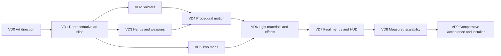

# Visual design milestones — Battlefield V / Bodycam / Warface quality goal

**T075 implementation update — 2026-11-15:** source `7407bc4` / installer 0.3.4 extends the earlier T074 baseline with real procedural surface triplets, scene material reuse, working map overviews and near-field weapon handling. Player captures still show blockout environments/soldiers. All VD exits, exact comparison approval and P05 disposition remain unchanged. [Implementation/evidence](milestones/m11-playable-release/handoff.md#t075--procedural-presentation-preview-034).

Owner direction, 2026-11-14: **the finished visual design should be as good as Battlefield V, Bodycam and Warface**. This is the target for perceived quality, coherence, physical credibility and presentation. Current parity is **unproven**. The b531da9 / 0.3.1 preview is an implementation baseline, with final interactive visual review Pending; it does not close these milestones.

This page is the canonical visual-quality track **VD0–VD9** inside the existing M8–M11 delivery programme. It replaces the five informal stages in the [brandbook](brandbook.md) as the execution order. M0–M7 historical closures, M8–M11 open gates, P05 FAIL and retained evidence remain unchanged. This assignment generates a plan; it creates no runtime coding lease, agent dispatch, toolchain change or acceptance waiver.

## Quality target and constraints

The target is a finished, grounded military FPS: convincing soldiers, tactile hands/weapons, coherent motion, detailed places, believable light/material response and a restrained professional interface. Reject mannequin-like anatomy, blockout-looking architecture, flat undifferentiated surfaces, floating equipment, detached hands, visible reload discontinuities and an interface that obscures combat. Adding menu scenery or more polygons alone does not establish this quality.

| Reference | Project design emphasis | Reference starting point |
|---|---|---|
| Battlefield V | Scene-led menus; strong composition and depth; readable world-first HUD; coherent environment/character presentation | Owner's supplied BFV menu and gameplay screenshots; [EA gallery](https://www.ea.com/games/battlefield/battlefield-5) |
| Bodycam | Physical material response, natural exposure, environmental depth, grounded weapon/camera presence | [Developer/publisher media on Steam](https://store.steampowered.com/app/2406770/) |
| Warface | Clear soldier/equipment silhouettes, readable combat feedback and polished weapon handling | [Historical official announcements/media](https://steamcommunity.com/app/291480/announcements/) |

These emphases are the project's art-direction choices. VD0 selects the exact comparison frames and video timecodes. Battlefield 6 and Call of Duty from earlier discussion remain secondary context; the latest primary quality bar is the three games named above. References inform original fictional factions, equipment and environments. Reference screenshots/footage are review material and never shipping textures, models, animation or background images.

The existing [vision](vision.md), [art boundary](vision.md#art-boundary), [performance contract](performance.md) and [Game-v1](game-session-contracts.md) remain binding:

- Unity 6 URP / C# / HLSL and the locked editor/packages. Geometry, surfaces, rigs, motion and effects come from code/numeric recipes; generated caches retain provenance. Engine font exception remains narrow.
- Native 1280×720 Low30 on Ryzen 5 4600H integrated Radeon / 16 GB DDR4-3200 / NVMe. Existing frame, CPU/GPU, allocation, residency, load and soak budgets apply. 60 FPS stays a separate stretch gate.
- One human plus local allied/enemy bots, three approved maps and both 5v5/6v6 rosters. Graphics quality cannot alter collision, navigation, visibility rules, hit volumes or weapon mechanics.
- No automatic import of photographic/scanned/AI textures, external character packs, authored skeletal clips or new online service. Bodycam-like camera effects must preserve aim truth and the reduced-motion/flash preferences.
- P05 FAIL under [ADR-024](decisions.md#adr-024--accepted-p05-soldier-visual-scope-stop-after-exhausted-clearance-iterations) remains. A future bounded owner assignment is required before another soldier-generator/clearance search. Planning that work here is not that assignment.

Whether the full quality target can be achieved within these constraints is an empirical question. VD1 must demonstrate a credible route. A failed feasibility gate returns a concrete quality/performance/provenance tradeoff to the owner; it cannot silently lower the target, reduce the roster, change resolution or convert an open gate into PASS.

## Milestone overview

All exits are Pending. T074 supplies partial software for VD7 and a useful baseline for other stages; its current staging soldiers and scenery are not accepted final art.

| ID | Milestone / concrete deliverable | Depends on | Existing programme |
|---|---|---|---|
| VD0 | Approved art direction, reference register and current-build gap inventory | Current source/evidence review | T062, T074; M10/M11 |
| VD1 | Reference-quality representative art slice with an early reference-machine feasibility capture | VD0; required bounded assignments | M8 integration / M11 visual and performance risk |
| VD2 | Final procedural soldier anatomy, uniform and equipment system | VD1; explicit P05 work scope | T049/T062, P05 / REL03 |
| VD3 | Detailed rifle/pistol, first-person arms/hands, magazine and analytic sights | VD1; stable rig/socket seam | T013/T038/T068; M8/M11 |
| VD4 | Coherent procedural locomotion and complete weapon-action presentation | VD2 + VD3 | T028/T032/T068/T072 |
| VD5 | Both maps rebuilt to the accepted environment art standard | VD1; authoritative map/nav ownership | T044/T045/T067; M10 |
| VD6 | Integrated materials, lighting, atmosphere and combat effects | VD4 + VD5 | T008/T030/T031/T038; M10/M11 |
| VD7 | Final scene-led front end and in-game interface using the accepted art | VD6; T074 baseline available | T046/T047/T069/T074; UI/SET gates |
| VD8 | Measured visual scalability, provenance and stable full-roster performance | VD7; continuous budget checks in every earlier stage | T070; REL04/REL05 |
| VD9 | Named comparative visual acceptance and final upgrading Windows installer | VD0–VD8 + existing release exits | T065/T073; REL01–REL06 |

Dependencies describe integration order. Any future parallel work needs explicit dispatch, bounded paths and separate worktrees/editor copies under [coordination rules](agent-coordination.md). Performance measurement begins at VD1 and continues at every stage; VD8 is the final consolidation, not the first optimization pass. There are no calendar or percentage-complete promises.

## VD0 — art direction and reference contract

**Deliver:** an approved reference register and visual brief covering composition, architecture/props, material families, daylight/interior mood, fictional factions/kit, weapon proportions, camera/motion language and UI typography/spacing. For each reference record game/version, source, frame/timecode, resolution, the quality being compared and any unknown FOV/capture conditions. Preserve originals and separate third-party reference material from procedural source/evidence. The six small images supplied in chat establish direction; higher-quality reference frames are needed for fine surface and motion review.

Capture the current source-matched menu, HUD, both maps, one soldier, both weapons and an action sequence. Record concrete gaps in [visual defects](visual-defect-inventory.md), including existing P05 defects. Define component owners, permitted paths, versions, comparison views and evidence locations. Identify any required new schema/socket/hit-pose change before dependent work. Establish the explicit scope needed for P05 work without changing its historical disposition.

**Exit:** owner approves one coherent visual brief and the comparison set; a technical reviewer records constraints/budgets and the gap inventory. Exact reference frames, art approval and new coding assignments remain Pending until supplied/reviewed. Current source is b531da9 / 0.3.1, with details in the [M11 handoff](milestones/m11-playable-release/handoff.md#t074--scene-led-menu-and-tactical-hud-preview).

## VD1 — representative art slice and feasibility

**Deliver:** one small, fully finished outdoor/indoor transition using production-intent procedural sources: a representative building/cover cluster, several material families, one convincing equipped soldier, visible hands plus rifle, a short idle/move/aim/fire/reload sequence, and the intended HUD/menu presentation. Produce actual release-player images and continuous action footage. Component prototypes may be bounded candidates, with their identities and unresolved defects explicit.

Review the near, medium and distant views against VD0 references at native720p Low. Exercise the representative assets in the existing full-roster workload and capture the applicable performance counters using normal benchmark definitions. Preserve the required 9/11 bots and gameplay. Identify total character/material/light/effect cost before replicating content across both maps.

**Exit:** the owner judges the representative view and action sequence reference-comparable in their relevant categories, and real hardware evidence supports the existing Low budget. A reduced beauty scene is visual evidence only; it does not replace full-product measurements. Missing reference hardware/counters remain PendingHardware. If the slice still resembles a blockout or fails the budget, retain the failure and decide the bounded next experiment before expanding production.

## VD2 — soldiers, uniforms and equipment

**Deliver:** a versioned procedural body/kit system with credible proportions, joint transitions, helmet/head/gloves/boots, layered uniform, armor, pouches, straps and weapon attachment. Both fictional teams read clearly through silhouette and labels as well as color. Near, middle and far LODs retain the accepted identity and equipment arrangement. Establish hands/rig/socket compatibility for VD3 and VD4.

Likely ownership: `Generation/Core/Soldiers/`, relevant numeric recipes/compiler, `Presentation/Rig/` and their tests; gameplay-pose changes remain with the integrator. Any generator change needs new identities and preserved old evidence. This stage cannot begin a new clearance search under a planning-only assignment.

**Exit:** approved neutral front/side/back/three-quarter views and live near/far views for both teams; topology/weights/bounds/LOD and existing pose/grip/clearance/hit-volume tolerances pass; known P05 defects have explicit resolved/unresolved records against the new candidate. A named new visual review is required. Historical P05 FAIL is retained even when a later candidate is accepted. See [soldiers and animation](features/soldiers-animation.md) and [soldier baseline](soldier-baseline.md).

## VD3 — first-person hands, weapons, magazines and sights

**Deliver:** original detailed rifle and pistol with credible dimensions, bevels/cavities, stable material regions, moving mechanical parts, visible magazines and first-person forearms/gloves/hands. Implement readable hip/ADS presentation, aligned analytic sights/optic reticle and correct near-wall composition. Every visible interaction has an equipment-relative hand target. First-person detail and world LODs share semantic sockets.

Likely ownership: `Generation/Core/Weapons/`, numeric weapon recipes, `Presentation/View/` and `Presentation/Rig/`. Preserve weapon definitions, ammo accounting, aim, fire/reload/equip durations and frozen socket/hit semantics. A new chamber/attachment/rendered-optic mechanic needs its own reviewed assignment/fixtures and measured budget; baseline optics remain analytic.

**Exit:** both weapons pass cold first bind, hip/ADS, near-wall and LOD/socket checks; close side/front/three-quarter and player views are approved. Hands stay connected to visible equipment, scope alignment remains truthful and there is no geometry clipping that hides the target. Tests and live captures cover both weapons after death/respawn and switching. See [weapon geometry](features/geometry-weapons.md) and [combat](features/combat.md).

## VD4 — procedural animation and weapon-action polish

**Deliver:** convincing distance-driven walk/run, crouch, sprint, slide, jump/land, turning, aiming and death collapse; grounded feet and weighted upper-body response. Complete idle/sway, shot/bolt/slide recovery, reload magazine removal/replacement and equip/holster/switch presentation. Include empty and nonempty magazine cases according to the existing authoritative states. Treat magazine/hand tasks as analytic equipment-relative trajectories and IK/dynamics, not authored joint-pose clips.

Drive actions from real snapshot/event timing, retaining pauses, life IDs and cancellation/reset boundaries. Add reduced-motion/flash variants through existing preferences. Preserve authority-owned movement and aim. Camera/weapon springs never apply authoritative recoil a second time.

**Exit:** uninterrupted clips show both weapons through fire → reload → ready and switch chains; full supported stance/aim range, slope/steps, slide and repeated death/respawn are reviewed. Existing pose sweeps, grip/foot limits, solver budgets and quality-independent gameplay checks pass. No snapping, detached magazine, drifting plant or life-reset residue remains in the accepted set. Sound cue synchronization uses the existing synthesized-audio policy; new recorded assets are not implied.

## VD5 — production environment art on both maps

**Deliver:** Training Compound and Depot Yard reach the accepted VD1 environment standard with distinct visual identities. Compound emphasizes believable concrete/plaster training structures and connected indoor/outdoor spaces; Depot emphasizes warehouses, steel, cargo and loading infrastructure. Add procedural architectural thickness, doors/windows/roofs/supports, curbs/drainage, believable ground transitions, bounded environmental wear and landmarks. Repetition must read as construction logic rather than repeated featureless boxes.

Version the grammar/recipes and material-scale rules. Classify detail as physical or cosmetic. Changes to cover, obstruction, sight lines or walkable geometry go through authoritative collision/native-nav publication, revisions and fixtures; purely cosmetic detail must preserve fair visibility across quality tiers. Keep the approved seeds and initial density ceilings until measured changes are explicitly accepted.

**Exit:** both maps pass approved near/mid/far and interior/exterior walkthrough views, readable enemy/ally silhouettes and existing MAP/T067 route/spawn/collision checks. Publish and verify complete packages, cold/warm reproduction and cross-quality gameplay equivalence. A prettier camera corner cannot accept the rest of a map. See [environment](features/environment.md) and [two-map requirements](features/playable-maps.md).

## VD6 — materials, lighting, atmosphere and effects

**Deliver:** a coherent procedural PBR material library with believable physical scale and distinguishable roughness/metal response; consistent exposure, sun/sky/interior bounce cues and atmospheric depth. Add bounded analytic muzzle/impact/dust/smoke effects, tracers where already supported, and synchronized synthetic feedback. Preserve target visibility and visual priority during combat. All textures/noise/caches originate from documented algorithms.

Use the locked URP pipeline and existing Low constraints. Additional lighting, post-processing, scope targets or effect complexity need profiling and bounded fallbacks within the accepted art direction. Camera distortion, blur and shake must respect accessibility and truthful aiming. Avoid adding costly effects to conceal weak geometry or rigging.

**Exit:** neutral-material turntables and bright/shadow/interior combat captures pass the agreed reference review; no pink/missing shader, unstable exposure, shimmering detail, unreadable team or obscuring persistent flash remains. Residency, shader variants, light/effect caps and resource teardown are measured in the player. See [materials/rendering](features/materials-rendering.md), [performance](performance.md) and T030/T031.

## VD7 — final menu, local lobby and combat interface

**Deliver:** the scene-led Main and local match setup use the accepted soldiers/environment/light; map cards match actual packaged maps. Complete the same visual language across loading, recovery, pause, settings, binding conflicts, display Keep/Revert, scoreboard, death/respawn, final results and replay. The in-game interface has a clear hierarchy for compass/score/time, map/squad, health, ammunition/action state and recent combat feedback.

T074's `ProductMenuScene`, `TacticalUi`, `ProductShellHost` and `ProductSessionView` are the current software base. Reuse their service boundaries while replacing provisional art and reviewing layout. The minimap must retain truthful friendly information plus temporary enemy gunfire reveals (ADR-058); silent enemies stay hidden. Keep keyboard/pointer access, saved controls/preferences, focus/pause and the 12-player tables. Populate only real local modes/settings.

**Exit:** named owner review of every screen and live state at native720p, both 100% and 150% UI scale; readable rendered contrast, no clipping/overlap, actual keyboard navigation and correct data/action timing. Verify the existing 20-cycle and UI/SET checks. Current software implementation and an editor render do not close this milestone. See [shell](features/game-shell.md), [brandbook](brandbook.md) and [M10](milestones/m10-maps-shell/validation-acceptance.md).

## VD8 — visual scalability and performance acceptance

**Deliver:** one stable source/content pair with coherent Low/Balanced/High LODs, material detail, shadow/effect scaling and loading behavior. Preserve silhouette, sights, team recognition and gameplay equivalence when reducing visual cost. Measure the menu scene separately and verify it is disabled/released correctly during gameplay; avoid hidden duplicate meshes, targets or skinning work.

**Exit:** the existing T070/M11 matrix passes on the actual reference machine: both maps × both roster sizes × three native720p Low captures, plus the required normal-AI soaks, correct counters, memory/allocation/load budgets and hardware/GPU/thermal evidence. Preserve failed runs; missing evidence is Pending/PendingHardware. Provenance, regenerated content, schema/contract guards and Server graphics isolation pass. Higher-tier images cannot substitute for Low evidence; 60 FPS remains separately labeled.

## VD9 — comparative sign-off and final delivery

**Deliver:** a final comparison pack, defect ledger and source-matched Windows installer, with controls/settings preserved through an actual newer-version upgrade. Use the same accepted source/content pair for visual review, normal gameplay, performance and packaging.

**Exit:** owner signs the comparison categories below; all critical visual defects are resolved and every retained limitation is explicit. Complete the original T065/REL/FIX matrix, including full normal matches/results/replay, recovery, clean installation, upgrade/repair/uninstall and installed rollback. Retain raw logs/video/captures, benchmark proofs, source/toolchain/content identities, installer SHA256 and rollback pair. Commit integrated work to main and preserve evidence before removing temporary worktrees. A trailer, screenshot set or installer build alone cannot close VD9.

## Common review and evidence contract

Review actual release-player output at native720p Low first; record higher-quality captures separately. Match scene purpose, subject distance and framing to VD0 references. Record unknown reference FOV/resolution/processing rather than claiming an exact technical comparison. Keep original references and capture metadata; no AI enhancement, upscaling or post-editing may stand in for rendered quality. Recorded gameplay video is evidence, not an authored skeletal animation source.

| Required category | Questions for the owner |
|---|---|
| Menu/UI craft | Does the composition, hierarchy, typography, spacing and interaction feel as finished as the chosen menu/HUD references? |
| Soldiers and equipment | Are proportions, silhouette, clothing/kit construction and deformation convincing at the reviewed distances? |
| Hands/weapons/actions | Do visible hands, sights, recoil, magazine exchange and switches form one physically credible continuous action? |
| Environment/material/light | Does each route feel like a real coherent place, with believable surfaces, depth, scale and lighting? |
| Motion/feedback | Do movement, contacts, weight, camera response, effects and synchronized cues remain convincing in uninterrupted play? |
| Whole-scene consistency | Do menu, world, characters, first-person art and HUD belong to the same finished product at Low? |

Use **0 Missing / 1 Blockout / 2 Functional / 3 Polished but below target / 4 Reference-comparable** as anchored review labels. Acceptance requires 4 in every category applicable to that milestone, the owner's written rationale and passing technical exits. Do not average away a weak character, action or environment score. These are subjective review decisions with evidence, not an objective numerical proof of AAA parity. Record reviewer names and roles; technical/AI self-review does not replace the owner's visual decision.

The comparison pack must include Main/local setup/settings/pause/results; both maps' interiors/exteriors and near/mid/far views; both teams and required LODs; rifle/pistol hip/ADS/fire/reload/switch; walk/run/crouch/slide/steps/turn/death/respawn; bright/shadow combat; reduced-motion/flash and UI-scale variants; and full-roster normal play. Use uninterrupted action footage as well as stills. Link to the existing M11 full-match/performance protocol instead of shortening it for this pack.

For every milestone attach: base/implementation commit, approved owner/paths, recipe/generator/schema versions, toolchain hash, content roots, map seed, profile/resolution/FOV/UI scale, scenario/input or event timeline, raw evidence paths, reference frame IDs, measured results, named visual decision, defects and rollback identity. Store raw local evidence under ignored `Artifacts/visual-design/<source>/<VD-id>/<run>/`; keep shared specifications here at docs root. Use existing fixture/docs, provenance, relevant pure/Unity/build/content wrappers and final package/installer checks from the [runbook](bootstrap-runbook.md). Tests, hashes and a populated folder never replace visual review.

## Next assignment

Begin with **VD0**, including review of the current 0.3.1 preview and selection of exact Bodycam/Warface comparison footage alongside the supplied Battlefield images. The working draft brief and gap register live in [visual-art-brief.md](visual-art-brief.md); owner approval and exact BODYCAM/WARFACE frame IDs remain Pending.

Owner-authorized parallel presentation polish (2026-11-14) may proceed on disjoint paths that do **not** change soldier-generator clearance, contracts or content locks: map-surface/atmosphere presentation, combat FX mesh wiring and menu/HUD craft. That work targets the brief as software only; it does not close VD0–VD9. Then assign one bounded VD1 art slice and its P05-dependent scope. The immediate plan is not to declare the existing menu/three staging soldiers final or expand the same provisional fidelity across two maps. All VD exits remain Pending until their actual evidence and owner decisions exist.
