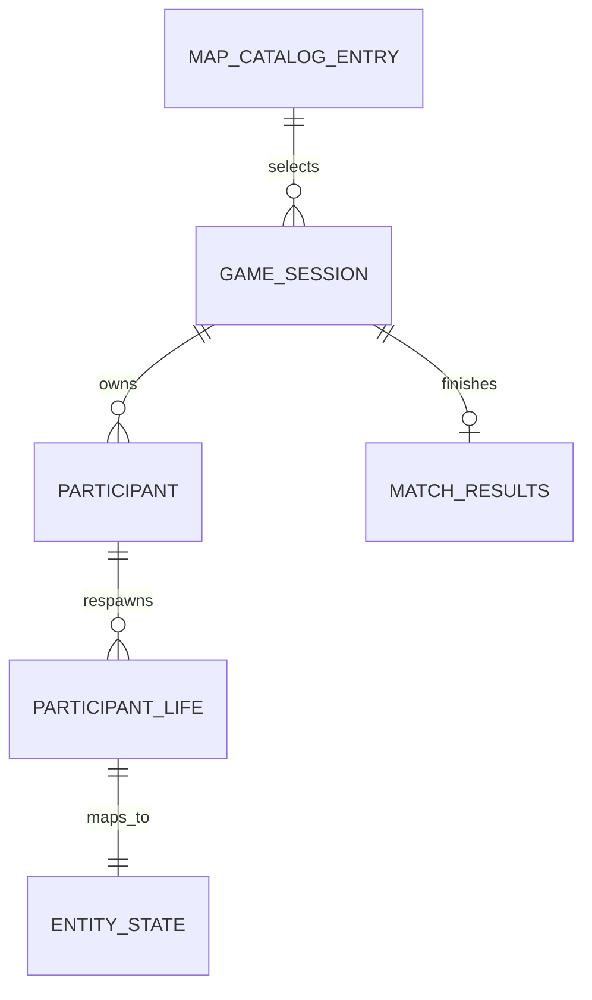
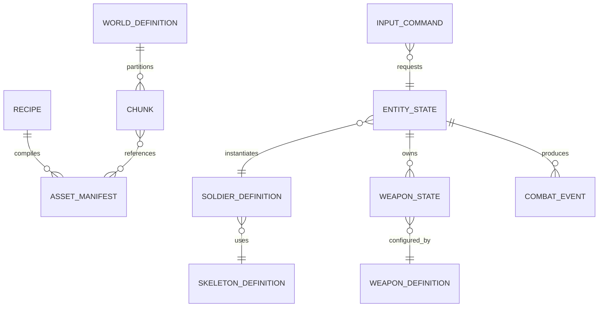

# Domain model

M8–M11 adds implemented Game-v1 product entities specified in [session contracts](game-session-contracts.md), with incomplete lifecycle integration documented in the [audit](product-state-audit.md). The existing table below remains the C0/generation baseline. ParticipantId is stable across respawns; LifeId maps each incarnation to a fresh EntityId. These are required invariants, not proof the current adapter correctly retires/rebinds lives. Team results remain independent of frozen C0 MatchState.

## Planned game entities

| Entity | Responsibility / invariant |
|---|---|
| MapCatalogEntry | Stable MapId → approved recipe/gameplay/visual identities and supported mode/sizes; two distinct layouts |
| SessionRequest | Validated map, mode, 5/6 team size, seed and rule version; cannot inject arbitrary recipes/paths |
| Participant | One human or bot on fixed team; stable name/stats and current life/entity; ≤12 participants |
| ParticipantLife | Fresh health/ammo/actions and EntityId; death idempotent, safe respawn after 180 active ticks |
| TeamMatch | Two scores, active tick count, 150-kill/54000-tick limits; full death batch before terminal evaluation |
| MatchResults | Immutable final team/participant stats, outcome/reason and content/build identity; survives unload |
| UserSettings | Versioned local sound/video/controls/accessibility values; cannot mutate gameplay rules/content |

These entities are specifications until T035–T047 compile/implement them. Exact ports, thread/lease ownership, versioning and fixtures stay in the shared contract plan. Existing motor units, team filtering and content lease invariants below continue to apply.

Normative field shapes are in [contracts](contracts.md); deterministic identity is in [generation](generation.md).

| Entity/value | Identity and contents | Owner / invariant |
|---|---|---|
| Recipe | RecipeId, schemaVersion, parameters, dependencies | Definitions; immutable validated source |
| GenerationRequest | recipe ID, seed, generator version, platform/profile | Compiler; canonical encoding |
| AssetManifest | content ID, source/build hashes, artifacts and bounds | Compiler; atomic immutable commit |
| WorldDefinition | world seed, generator set, chunk grid and gameplay recipe | World; independent of visual quality |
| Chunk | integer X/Z, collision/nav hash, visual handles, state | World; playable only when critical payloads ready |
| MaterialDefinition | physical scales, PBR values, generator and layer IDs | Presentation; no combat semantics |
| SkeletonDefinition | joint IDs, parents, bind transforms, limits | Rig; stable joint IDs across LODs |
| SoldierDefinition | anatomy, equipment, rig ID, gameplay capsule and hit profile | Simulation selects hit profile; views consume rig |
| WeaponDefinition | mechanics, fire interval, magazine, recoil/ballistics IDs | Simulation; immutable during match |
| EntityState | EntityId, transform, velocity, stance, health, team | Authority; finite values and valid transitions |
| WeaponState | owner ID, ammo, action phase, next fire tick, reload completion | Authority; ammo never negative |
| InputCommand | tick, sequence, movement, aim, button edges | Input/network; validated before use |
| CombatEvent | event ID, tick, instigator, target, result | Authority; deduplicated by view and transport |
| MatchManifest | build/protocol/schema, world/collision/weapon hashes, seed | Server; clients agree before spawn |

## Invariants

One authoritative entity record per nonzero ID, IDs never reused within a match. Health ranges 0..max; death is an idempotent state transition. Team filtering runs before damage. Weapon definition and hit profile versions are frozen for a match. View skeleton joint IDs are not network object IDs. Render LODs can omit fingers and surface detail but cannot remove authoritative hit capsules.

All gameplay lengths are meters, durations seconds/ticks, angles radians internally, velocities m/s. Unity adapter uses +Y up, +Z forward, +X right; pure DTO vectors follow the same convention. Absolute world position remains bounded in first slice; floating-origin support is deferred. Source measurements explicitly tag degrees if author-facing, converted once at validation.

Chunk state is Absent → Requested → Reading → Validating → Installing → Ready → Retiring → Absent; cancellation returns to Absent after releasing leases. Faulted is terminal for that request and records error code. Retiring waits for active simulation references and fences. No chunk can publish Ready with only visual content installed.
