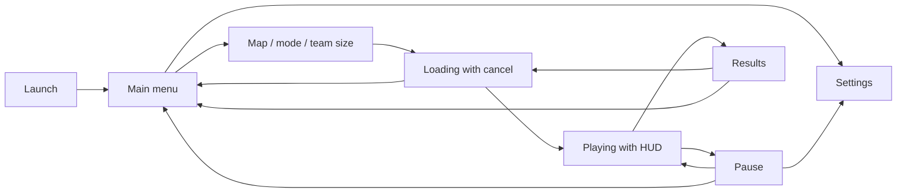

# Feature: menu, match UI and persistent settings

T074 (owner-assigned 2026-11-14) replaces the default-box shell/debug HUD styling with the [implemented tactical design](../brandbook.md#implemented-shell-and-hud). Main, local setup, loading, pause/confirms, four settings categories, team-column live/results tables and the combat HUD use logical scaled coordinates. Existing session/navigation/settings services remain in charge. The gameplay HUD shows formatted active-time remaining, health/ammo, authoritative reload phase and respawn feedback; it hides during shell menus. Actual player checks and retained limitations are recorded in the [M10 handoff](../milestones/m10-maps-shell/handoff.md), separately from formal UI/SET/REL acceptance.

Status reviewed after T069: ProductShellHost implements Main/Setup/Loading/Playing/Paused/Results, live tables and schema-2 settings editor/store/applier with audio binding. Editable bindings support conflict swap/cancel, defaults, staged Apply/Cancel and persistence; `LocalPlayerInput` and scoreboard/pause read applied bindings while reserved Escape keeps recovery. `ApplyUserSettings` consumes bindings plus ReducedFlash (suppresses cosmetic muzzle flash overlay), ReducedCameraMotion (disables cosmetic ADS FOV zoom) and Subtitles (transient captions for shot/impact/hit/reload/UI cues). Resolution options come from real `Screen.resolutions` (≥1280×720); empty enumeration falls back to 1280×720 and 1920×1080 only. Pending display is not written until Keep, so focus-loss/timeout/restart roll back. Named 720p/keyboard/pointer/display/audio device review, audible gain/mute sign-off and 20-launch soak remain Pending (FIX08–FIX10 / SET01–02). T086 / ADR-055 replaces beep synth tones with a generated PCM combat sample bank; see [audio](audio.md).

## Screens and navigation

Main menu: Play, Settings, Quit. Setup shows catalog map names and text descriptions, mode selector containing only Team Deathmatch for each map, team-size choice 5v5/6v6, fixed “150 kills / 15 minutes” summary and Start/Back. No external screenshots, preview sprites, disabled future modes or networking controls are required. Show only maps with valid packaged dependencies; if none, show a recoverable content error. Start validates map/mode compatibility before loading and disables double submission.

Loading shows meaningful phase text and Cancel; errors return to setup/main with retry and a short message. Escape in gameplay pauses all local simulation and unlocks/shows the cursor. Pause offers Resume, Settings, Restart match and Main menu. Restart/leave confirm loss of current progress, using the same input focus rules. Focus loss pauses. Opening the live scoreboard does not pause or unlock aiming; at finish the [results table](team-deathmatch.md) takes focus. Escape/Back returns to the prior screen without leaking clicks or firing the weapon. Text entry and modal dialogs consume input before gameplay.

Keyboard and mouse are required: tab/shift-tab, arrows, Enter/Space, Escape, visible focus and pointer click; no controller requirement in this release. All gameplay controls are listed and rebindable, including move, look, aim, fire, reload, sprint, crouch, jump, slots, scoreboard and pause. Reserved Escape always restores menu access. Duplicate binding conflicts are shown and require swap/cancel, never silently replace an unrelated action.

## Settings schema and application

Chosen defaults below extend the existing baseline. Units are visible to players. Apply/Cancel edits a working copy; Restore defaults also stages changes. Settings are local presentation/input preferences; no graphics option changes collision, nav, weapon timing, sensing or roster.

| Group / field | Initial default and supported range | Runtime behavior |
|---|---|---|
| Audio master / effects / UI | 1.0 / 1.0 / 0.7, each 0–1 | Apply to actual device output including existing voices (ADR-055 sample bank + mixer); 0 means mute; preserve ≤24-voice/limiter policy; combat PCM bank is generated/provenance-recorded, not a music score requirement |
| Quality | Low; Low/Balanced/High | Apply verified visual profile; show unsupported/missing content explicitly; no arbitrary render-scale slider |
| Resolution | 1280×720 initial; supported display modes ≥1280×720 | Offer only device-supported sizes; native internal size at baseline, window/borderless/fullscreen as supported |
| Display mode / VSync / FPS cap | Windowed / off / 60; cap 30,60,120,uncapped | Device adapter applies; benchmark override uses VSync off/uncapped without rewriting user settings |
| Vertical hip FOV | 80°, 70–100° | ADS ratio 60/80 as baseline; never changes authoritative aim/hit pose |
| Mouse sensitivity / invert Y | 0.10 degrees per input delta unit, 0.01–1.00 / off | Specify and freeze input-delta scaling in T035; frame-rate independent; player input yaw/pitch remains validated |
| UI scale | 100%, 100–150% | Reflow/scroll at 720p; do not scale beyond safe area |
| Reduced camera motion / flash | off / off | Cosmetic only; preserve shot/hit/action information |
| Key bindings | Baseline keyboard/mouse map, frozen T035 | Validate every action, conflict/reserved bindings and persist; defaults remain recoverable |

Retain the existing contrast preference 0.8–1.5 (default 1.0) only with validated readable palette combinations; reject combinations failing 4.5:1 text contrast. Team identification also uses text/shape. No change to existing pure HudSettings serialization is assumed; migrate through the adapter with tests if used.

Resolution/fullscreen changes enter a **15-second real-time confirmation**: Keep or Revert; timeout, focus loss or app restart before confirmation restores the last confirmed mode. This timer runs even while the game is paused. Apply other groups only after validation; cancel restores the previous live preview. Unsupported device choice keeps the confirmed setting with a message. A failed quality load keeps the previous complete profile and releases partial leases.

Settings live at platform `Application.persistentDataPath` via an injected path/storage adapter, separate from content/manifests. Versioned JSON uses bounded input (≤64 KiB), finite numeric validation, atomic temporary-write/replace, and a preserved last-good file. Missing file uses defaults; corrupt file is quarantined with diagnostic and defaults; older supported version migrates; newer schema loads safe defaults **without overwriting that file**. Read-only storage leaves usable in-memory settings and a nonblocking “could not save” message. Never include absolute local settings paths in portable build manifests.

## Runtime and visual acceptance

Menus bind read-only catalog/match/results models and send requests through session services; they cannot spawn entities, alter score or call simulation mutation directly. Actual Unity UI/font/text, camera, cursor locking, audio callback/output and settings device adapters are required; a pure layout test or serialized string is insufficient.

Verify 1280×720 at 100% and 150% UI scale, live 12-row scoreboard and final results without overlap, mouse/keyboard navigation, focus restoration, settings persistence after relaunch, all audio channels/mute, quality and display rollback, remapped controls and no gameplay input leakage. Missing/unavailable audio device produces a recoverable warning and permits play; it must not pretend audible playback was verified. Capture real player screenshots and a named reviewer record under M10/M11; no painted UI assets are introduced.

## Slide binding compatibility (ADR-039)

T072 adds Slide (default Key.F), displayed as “Slide (hold Sprint)” in settings. Default chord is Left Shift + F while sprinting forward. Apply/Cancel, conflict swap, Restore defaults and persistence use the existing binding editor. Existing schema-2 controls are preserved: missing Slide adds F only if unused, otherwise Unbound so F's previous action keeps working. Rebind Slide explicitly in that case. Schema ID/version remains 2, with legacy and new-slide fixtures plus migration/rebind/roundtrip tests. See [combat rules](combat.md#local-sprint-slide--t072--adr-039) and [playtest guide](../playtest-guide.md) for build availability; the old 7cd7e81 archive does not contain this addition.

## Last-weapon binding and local muzzle overlay (ADR-056)

Owner playtest fix: additive optional `LastWeapon` (default Key.Q, settings label “Last weapon”) toggles the previous rifle/pistol slot client-side into the existing selected-slot command. Legacy schema-2 files gain `LastWeapon=Key.Q` when free, or `Unbound` when Q is already customized; multiple unbound additive actions are allowed. The cosmetic full-screen muzzle flash and “Shot” subtitle apply only to the local human’s `ShotAccepted`; bot/remote shots keep world muzzle proxies and audio without flashing the screen. See [ADR-056](../decisions.md#adr-056--accepted-last-weapon-quick-switch-q-and-local-only-muzzle-overlay).
