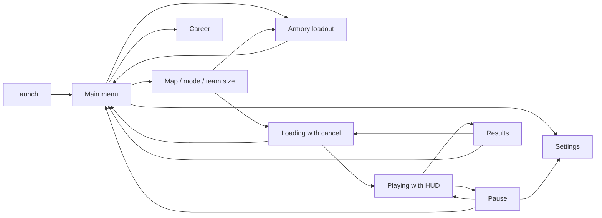

# Feature: menus, Armory and persistent settings

`ProductShellHost` runs the screens:
- Main;
- Setup;
- Armory;
- Career;
- Settings;
- Loading;
- Playing;
- Paused;
- Results.

The screens are drawn by `TacticalUi` with the [UI design system](../brandbook.md). They bind read-only catalog, match and results models and send requests through session services. They never spawn entities, change the score or call simulation mutation directly.

Settings use the schema-2 editor, store and applier ([ADR-036](../decisions.md#adr-036--accepted-usersettings-schema-2-shell-coverage-t060--fix09)).

## Screens and navigation

**Main.** Main has Play, Armory, Career, Settings and Quit, with the current loadout shown underneath.

**Setup.** Setup offers:
- the catalog maps with their descriptions;
- Team Deathmatch;
- the team size (5v5, 8v8, 10v10 or 15v15);
- a fixed "150 kills / 15 minutes" summary.

Only maps with valid packaged dependencies are listed. Start validates the selection and disables double submission.

**Loading.** Loading is the insertion briefing (`TacticalUi.DrawInsertionScreen`). It shows live phase text and an indeterminate bar, never a percentage. `StartSelectedMatch` yields, so the screen paints before the synchronous package and nav work. Cancel stays available. An error returns to the previous screen with a retry and a short message. A cold start shows the same layout through `BootLoadingHost`.

Copy lives in `ShellUiCopy` and `InsertionScreenCopy`. The typeface is Barlow Condensed ([ADR-066](../decisions.md#adr-066--accepted-non-commercial-ui-typeface-bank-barlow-condensed)).

**Pause.**
- Escape pauses the local simulation and shows the cursor.
- Focus loss also pauses.
- Pause offers Resume, Settings, Restart and Main menu. Restart and leave ask for confirmation.

**Scoreboard and results.** Holding Tab shows the scoreboard without pausing. At the finish, the [results table](team-deathmatch.md) takes focus.

**Input rules.**
- Back never leaks a click or a shot into gameplay.
- Modals consume input before gameplay does.
- Keyboard and mouse are required: Tab/Shift-Tab, arrows, Enter/Space, Escape, a visible focus marker and pointer clicks.

## Armory (ADR-107)

The Armory ([ADR-107](../decisions.md#adr-107--accepted-armory-loadouts-and-reusable-rail-mounted-sights)) sets what the player takes into every match. You reach it from Main or from Setup.

**Layout:**
- **Left: slot tabs.** Primary and Sidearm. Knife and grenade are standard issue.
- **Middle: guns** (`ArmoryCatalog`). Each shows its icon, fire mode, damage, magazine and rate.
- **Right: sights** the primary can mount, each with a one-line effect. Each gun remembers its own sight.

**Locking.** Guns and sights above the player's career rank show as locked. The header shows the rank and CP bar ([career](career.md)).

**Saving.** Every change saves at once to `shooter-armory.json` (`shooter.armory.v1`), with the same atomic, last-good and quarantine rules as settings. The fixtures are in `docs/armory-fixtures/`.
- Unknown ids fall back per field: the M16 with the 2x prism, and the G17.
- A save failure keeps the picks for the session and shows a message.

**At spawn.** `OfflineGameSession.UseArmoryLoadout` applies the loadout to the human on every spawn. Bots keep random guns and sights.

## Settings

Settings are local presentation and input preferences. No option changes collision, nav, weapon timing, sensing or roster. Apply and Cancel edit a working copy. Restore defaults also stages changes.

| Field | Default and range | Behavior |
|---|---|---|
| Audio master / effects / UI / music | 1.0 / 1.0 / 0.7 / 0.6, each 0–1 | Applies to the live output; 0 mutes |
| Quality | Low; Low / Balanced / High | Verified visual profile only |
| Resolution | 1280×720; device modes ≥1280×720 | From `Screen.resolutions`, falling back to 1280×720 and 1920×1080 |
| Display mode / VSync / FPS cap | Windowed / off / 60 (30, 60, 120, uncapped) | Benchmarks override without rewriting user settings |
| Vertical hip FOV | 80°, 70–100° | Never changes authoritative aim |
| Mouse sensitivity / invert Y | 0.10, 0.01–1.00 / off | Frame-rate independent |
| UI scale | 100%, 100–150% | Reflow or scroll at 720p |
| Contrast | 1.0, 0.8–1.5 | Combinations below 4.5:1 text contrast are rejected |
| Reduced camera motion / flash, subtitles | Off | Cosmetic only (see below) |
| Key bindings | Defaults in `GameData.DefaultBindings` | Every action can be rebound |

What the accessibility options do:
- **Reduced flash** suppresses the muzzle overlay.
- **Reduced camera motion** disables cosmetic ADS zoom and PiP blur.
- **Subtitles** caption shot, impact, hit, reload and UI cues.

**Bindings.** A conflict asks you to swap or cancel; it never silently replaces another binding. Escape is reserved and always restores menu access.

Added optional actions fill in defaults on legacy files, and the schema stays 2:

| Action | Default | ADR |
|---|---|---|
| Slide | F, with Sprint held | [ADR-039](../decisions.md#adr-039--accepted-local-authoritative-sprint-slide-t072) |
| Last weapon | Q | [ADR-056](../decisions.md#adr-056--accepted-last-weapon-quick-switch-q-and-local-only-muzzle-overlay) |
| Pickup | G | [ADR-105](../decisions.md#adr-105--accepted-dropped-primary-weapons-and-g-pickup) |

When an added action's default key is already taken, it becomes Unbound.

**Display changes** enter a **15-second real-time Keep/Revert** confirmation. Timeout, focus loss or restart before Keep restores the last confirmed mode. The pending mode is never written until Keep. An unsupported choice or a failed quality load keeps the previous setting and shows a message.

**Storage** is `Application.persistentDataPath`, through an injected adapter.
- **File format.** Versioned JSON of at most 64 KiB, with finite-number validation. Writes are atomic and the last good file is kept.
- **Missing file:** defaults.
- **Corrupt file:** quarantined, then defaults.
- **Older schema:** migrated.
- **Newer schema:** safe defaults, and the file is **never overwritten**.
- **Read-only storage:** settings work in memory, with a "could not save" message.

## Acceptance

The real Unity UI, cursor, audio and device adapters are required. A pure layout test is not enough.

**Checks (UI01–UI02, SET01–SET02, FIX08–FIX10):**
- 1280×720 at 100% and 150% UI scale;
- live and final tables with no overlap;
- keyboard and mouse navigation, and focus restoration;
- persistence after relaunch;
- every audio channel and mute;
- quality and display rollback;
- remapped controls;
- no input leakage;
- 20 launch cycles.

A missing audio device gives a warning, and play continues. Named review is Pending.
