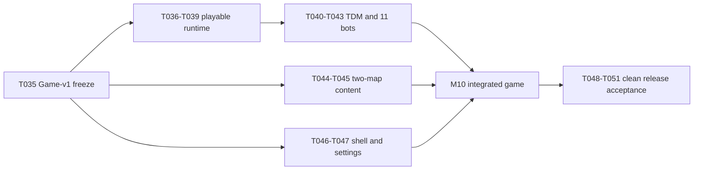

# Playable bot release — next development order

Planning baseline: 2026-11-13, source `ad4544f`. This assignment prepares documentation only. M0–M7 remain administratively closed under their recorded waivers; M8–M11 below are new, **planned and unassigned**. No new game tests, build or release acceptance is implied. Start future implementation at [M8](milestones/m8-runtime-composition/index.md), under one integrator, before dispatching feature workers.

## Target the owner can play

A Windows x64 offline build launches into a menu. The player selects one of two distinct procedural maps, Team Deathmatch, and 5v5 or 6v6. One human joins Team 1; bots fill every other slot on both teams. Teams race to 150 enemy kills, with a 15-minute active-play limit. A results table follows, with replay and return-to-menu actions. Sound, video, controls and accessibility settings persist between launches.

Interpretation of “15 mins left”: **15 minutes elapsed / countdown reaches zero**. Defaults chosen for implementation: 5v5 selected initially, 6v6 also required; score/time limits fixed for this release; ties at the deadline are draws without overtime. These are explicit product defaults, changeable before the M8 contract freeze. [Team-match rules](features/team-deathmatch.md), [map catalog](features/playable-maps.md), [menu/settings](features/game-shell.md) and [session contracts](game-session-contracts.md) are normative for this new scope. Compound Clear remains a regression/diagnostic mode and is absent from the public mode selector.

## Review of what exists

| Evidence / actual source | Reusable foundation | Gap to this target |
|---|---|---|
| [M0–M2 handoffs](milestones/m2-combat-harness/handoff.md); `Bootstrap/Runtime/FoundationEntry.cs` | Locked editor, client/server build wrappers; 60 Hz motor, weapons, hit poses and combat harness | Default runtime builds a 10 m floor and box, installs empty-actor combat authority, submits empty commands; it does not compose the requested game |
| [M3 handoff](milestones/m3-generated-compound/handoff.md); `Generation/Core/Environment`, `World/Navigation`, `World/Streaming` | Numeric compound plan, connectivity checks, revisioned path seam and visual streaming scheduler | Need actual map compilation/packaging, Unity collision/nav installation and rendered map/actor lifecycle; planner and delegate tests alone do not prove runtime navigation |
| `Simulation/AI/CombatAiDirector.cs`, `PerceptionSystem.cs` | Bounded sensing, covers and normal-command intent | `MaxBots=8`, `Plan(...SenseTarget? playerTarget...)`; nine/eleven bots need enemy selection, allied behavior, fair scheduling, real path-corner following and state from authority |
| [M4 handoff](milestones/m4-offline-slice/handoff.md); `Simulation/Match/CompoundClearMatch.cs` | Pure objective/restart rules | One human against eight enemies, no respawn; cannot supply team scoring, deadline or results |
| `Presentation/Hud/HudLayout.cs`, `Presentation/Audio/SynthAudioMixer.cs` | Pure layout/settings and synthesized voice helpers | Need actual interactive UI, input/camera/cursor lifecycle, device audio adapter, versioned settings read/write and application to live services |
| [M5–M7 handoffs](milestones/m7-hardening-stretch/handoff.md) | Pure codec/prediction/recovery and release tools | Unity/player validation pending, remote UTP version unpinned; neither blocks local offline composition; no LAN/public UI in this release |
| [M1 handoff](milestones/m1-procedural-feasibility/handoff.md), ADR-024 | Numeric soldier/rig generator and galleries | P05 remains FAIL / not accepted; live soldier readability, skin/pose defects and acceptance need an explicit bounded remediation task |

Paths in this table are under `UnityProject/Assets/Shooter` unless noted. Closure summaries formerly saying three of eight closed are superseded in the root navigation pages. Historical handoffs/reports/waivers are preserved. M4 explicitly records no player binary at close; M7 records player rehearsal pending. Administrative closure is not playable-release evidence.

Current-source audit during planning: `Tools/Test-SourceProvenance.ps1` fails with **51 missing metadata entries and one unapproved Markdown source** (`Tests/EditMode/View/ProceduralViewModelEditMode.md` under Assets). These predate the documentation changes; no Unity source was edited here. The M7 regression tool records lock-file presence/hashes and does not replace the full asset-source audit. T035 must repair the tracked metadata/source layout through integrator ownership and rerun the audit before accepting new runtime work; do not allowlist the whole Assets tree or disable the guard. The locked editor executable is present at the ignored local configured path on this machine, although earlier closing workers lacked it; current installation presence alone proves no fresh build or license/module acceptance. See [planning validation](planning-validation.md) for the actual check record.

## Recommended order

| Order / gate | Concrete result | Why it comes here |
|---|---|---|
| 1 — [M8 Runtime composition](milestones/m8-runtime-composition/index.md), T035–T039 | Frozen Game-v1 seams, one generated compound in an actual player, working input/combat/AI/view/audio path and safe teardown | Establishes an executable vertical path and exposes missing adapters before expanding gameplay or content |
| 2 — [M9 Team Deathmatch](milestones/m9-team-deathmatch/index.md), T040–T043 | One-map 5v5 and 6v6 with allied/enemy bots, scoring, respawn, timer and immutable results data | Proves the whole match loop before multiplying maps; 11 bots is a new measured capacity |
| 3 — [M10 Maps and game shell](milestones/m10-maps-shell/index.md), T044–T047 | Two packaged maps, map/mode/team-size selection, pause, scoreboard/results, persistent settings | Turns the loop into an independently usable game; map and shell workers can prepare independently after Game-v1 freeze |
| 4 — [M11 Playable build acceptance](milestones/m11-playable-release/index.md), T048–T051 | Clean installable release archive, accepted soldier presentation, full match tests and reference performance evidence | Closes real delivery gaps using the exact two-map, 12-actor workload |

These are dependencies, not dates. Exit gates are serial; bounded work inside them may overlap as described in [agent coordination](agent-coordination.md). M10 map planning and shell models may run against frozen fakes after T035, but cannot be accepted before M9. Do not start all milestones merely because their docs exist. M8 also defines the performance workload early; M11 collects final evidence rather than designing the benchmark late.

## Acceptance boundary and remaining risks

The release must run without Unity, a developer cache, internet or a separate server process. It ships all verified gameplay and visual content. One human plus bots is the release topology; 6v6 does not authorize 12 networked humans or T025 projectiles/penetration. Preserve compile-time server isolation and old network tests without adding a remote transport dependency to offline play.

Historical waivers apply only to their historical milestone closures. M8–M11 need fresh real Unity/player evidence for their stated exits. Missing editor, native counters or reference hardware remains Pending, with pure work allowed to continue independently. Do not carry waivers forward automatically or declare “ready build” from green pure suites. Mandatory performance remains native 720p Low 30 FPS under [performance](performance.md), including the 6v6 workload; 60 FPS is separate stretch.

P05's failed clearance/skin acceptance is a visible release risk. T039 investigates/fixes the live visual path; T049 requires review against explicit defects and the original tolerances. If source recipes/generators must change, preserve old failed evidence and follow provenance/version migration. No implicit acceptance of the old skin, external art fallback or unreviewed requirement reduction is authorized.

## Future implementation entry

Read [implementation start](implementation-start.md), M8's full pack and the [contract plan](game-session-contracts.md). Integrator records an actual base commit, named owners, exact allowed paths, fixture hashes and lock versions in `coordination.json` only when implementation is assigned. This planning task does not create worker leases or alter existing locks. Every completed future task lands on `main`, checks pass, evidence is retained, and temporary branches/worktrees are removed after preservation is verified.
