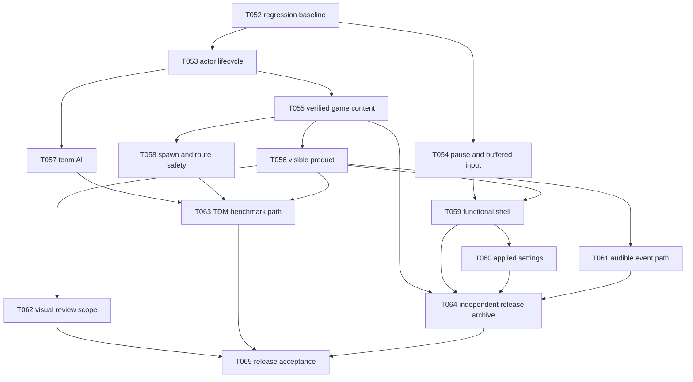

# Offline release remediation — implementation tasks T052–T065

Original baseline: [audit](product-state-audit.md) at f3d9954; T052–T064 remediation landed at 59316d3. This plan retains original requirements/scope rather than asserting every card is unstarted or accepted. Current dispositions live in the [remaining queue](next-playable-build.md) and audit. REL01–REL06 remain Open / NotClaimed; P05 FAIL remains. Work completes M8–M11 without M12 or inherited waivers.

Current 84befb9 / a54ed83 review: the verified `7cd7e81` archive exists. T066 baseline and T068/T069/T070 software are landed; remaining T067 native publication/query work, T071 manual handoff and T062/T065 acceptance are in the [current queue](next-playable-build.md). Original cards below are retained scope, not instructions to reimplement repaired features.

## Entry, ownership and compatibility

Read [implementation start](implementation-start.md), [vision](vision.md), [architecture](architecture.md), [contract details](contract-details.md), [Game-v1](game-session-contracts.md), the affected milestone pack and original T035–T051 card. One integrator owns Bootstrap, Contracts, asmdefs/test projects, settings/project/package files, locks/registries/schemas, workload definitions and coordination.json. Keep Unity 6000.3.28f1 / URP 17.3.0 and the existing verified installation; configure fresh copies with Tools/Configure-Unity.ps1. No package or editor upgrade is part of these repairs.

Game-v1 is already compiling/frozen under ADR-034. Do not repeat T035 or treat its freeze as proof that every required behavior is covered. Before implementation the integrator records current accepted main, owner, exact allowed files, fixture/lock hashes, commands, rollback pair and evidence path. No automatic delegation; parallel work needs explicit authorization, bounded ownership and separate worktrees/editor copies. Shared files integrate serially.

Frozen semantic or format changes require ADR plus fixtures/migration before consumers: C0, Game-v1, SGAF, generator/recipe/nav identities and N1. ADR-036 now extends UserSettings to schema 2; ADR-037 adds depot workloads. Preserve these reviewed extensions and their fixtures; do not repeat the prior compatibility work or invent an undocumented parallel contract. T069/T070 implementation consumers are landed; named device/player and reference measurement evidence remains pending. Nonbreaking implementation repairs must preserve current identities.

## Order and milestone mapping

Arrows show dependencies, not authorization to dispatch concurrent workers. T060 freezes the reviewed settings-applier seam and can implement against test fakes; T061 then binds real audio, after which both tasks receive joint device acceptance. A staged pure merge does not close either device gate. In addition, T054 integrates before T056/T059 player acceptance, T057/T058 before T059 full-match acceptance, and T063/T064 use the same final candidate for T065. Repair performance collection early enough to guide integration; do not defer workload design until final sign-off.

| Task | Gate / original work | Dependencies | Owner role | Exit |
|---|---|---|---|---|
| T052 | Regression / T035,T048 | Audited baseline | Integrator | FIX01 |
| T053 | M8–M9 / T036,T041 | T052 | Simulation integrator | FIX02 |
| T054 | M8 / T036,T038 | T052 | Bootstrap/client integrator | FIX03 |
| T055 | M8,M10 / T037,T044–T045 | T052,T053 seams | Content/world + integrator | FIX04 |
| T056 | M8 / T038–T039 | T053–T055 | Presentation + integrator | FIX05 |
| T057 | M9 / T042–T043 | T053; real-map acceptance T055 | AI | FIX06 |
| T058 | M9–M10 / T041,T044–T045 | T053,T055 | World/match | FIX07 |
| T059 | M10 / T046 | T053,T054,T056; full match T057–T058 | Client + integrator | FIX08 |
| T060 | M10 / T047 | T059, reviewed settings seam | Client/settings + integrator | FIX09 |
| T061 | M8,M10 / T038,T047 | T053,T056; settings binding T060 | Audio/client | FIX10 |
| T062 | M8,M11 / T039,T049 | T056 | Character/reviewer + integrator | FIX11 |
| T063 | M9,M11 / T043,T050 | T055–T058, reviewed workload extension | Measurement integrator | FIX12 |
| T064 | M11 / T048,T051 | T055,T059–T061 | Release integrator | FIX13 |
| T065 | M11 / T049–T051 | T052–T064 accepted candidate | Integrator + named reviewers/reference operator | FIX14 / REL01–REL06 |

## T052 — Restore trustworthy regression execution

Allowed scope: Tools/Contracts.Tests/packages.lock.json, affected Tools project references/wrappers and their meaningful guard tests; integrator only. Compare the existing project graph with locks, repair the stale project-reference entries using the locked SDK and restore workflow, and review the exact dependency diff. No dependency upgrade or global unlock. Preserve the NU1004 audit failure. Run Test-Contracts, Test-Generation, Test-Simulation and Test-Game with actual nonzero counts/zero skipped. Fix wrapper false-PASS/count/exit propagation if discovered; a filtered run finding no tests must fail. Record offline advisory lookup separately from test execution. FIX01 is prerequisite to accepting further fixes.

## T053 — Complete bounded actor and participant lifecycles

Allowed scope: Simulation/Foundation/CombatHarnessSimulation.cs, Simulation/Session/, Simulation/TeamDeathmatch/, Game/Session/ and their pure/Unity integration tests; shared wiring through integrator. Give authority real retirement/reset semantics without a second damage system. Resolve ordered death credit before retiring the old life; remove it from active authority/hit snapshots and lifecycle storage. Allocate monotonic fresh EntityIds without basing IDs on a shrinking collection count. Keep participant stats stable, update the local human identity/input/camera and register the replacement bot with a reset state and correct sequence epoch. Cancel old paths/cover/actions/events. Bound active actors at 10/12 and cosmetic corpses at four/five active seconds; historical dead actors must not accumulate. Finish/abort cancels queued respawns, and stale-session work cannot affect the next match. FIX02 must exercise real harness authority, not only RecordingLifecycle.

## T054 — Correct pause, focus and input timing

Allowed scope: Bootstrap/Core tick orchestration, Bootstrap/Runtime/FoundationEntry.cs, Presentation/Input/, ProductSessionView and meaningful integration tests; integrator owns shared files. Stop authority advancement while paused/loading/results rather than converting normal Busy into fatal error. Resume resets wall-clock baseline without catch-up or lost tick order; focus loss follows the same policy. Sample frame input once, retain button edges until consumed and apply mouse delta once across zero/multiple simulation ticks. Persist selected weapon between commands; clear captured edges at focus/menu/life boundaries. Verify sensitivity units, aim limits, movement normalization and no gameplay input while a menu owns focus. Diagnostic smoke behavior stays explicit and unchanged.

## T055 — Implement genuine compiled map/content delivery

Allowed scope: Tools/Compile-GameContent.ps1, Tools/Test-Maps.ps1, compiler/editor map code, Generation/Core/Environment where required, Content/Maps/, Content/Runtime/, World/Foundation/CompoundMapRuntime.cs and World/Runtime/; locks/encoding changes integrator-owned. Replace the test-only compiler wrapper with exact map/profile/recipe dependency enumeration and atomic verified publication. Map selection must determine output; reject unknown selection and incomplete dependencies. Include geometry/materials, collision/nav, soldiers/rigs, weapons/shaders and font exception. Catalog roots reference actual manifest/payload bytes, not label hashes. Release loads verified content with no map compilation, developer path or random regeneration. Encoding boundary accepted under [ADR-035](decisions.md#adr-035--accepted-verified-release-map-packages-t055-boundary) (`shooter.map-package.v1`, map metadata for stable IDs, `unity.navmesh.bake.v1`); implement publication/load against that boundary rather than inventing a parallel format. Existing pure pathfinding can be retained only after demonstrating required native-world reachability; a source comment cannot waive that requirement. Cold/warm/forced reproduction, cancellation/corruption and server gameplay-only closure are part of FIX04.

## T056 — Compose visible map, actors and weapons

Allowed scope: Presentation/Rendering/, Rig/, View/, Session/ and client Bootstrap wiring via integrator. Consume verified generated content and coherent authority snapshots; show map surfaces/cover, every living participant with distinct team identification, procedural soldier rig/motion, held weapons and local weapon/view feedback. Reuse generator/rig libraries without launching gallery scenes or importing art. Interpolation is read-only and cannot change hit poses; quality changes visual detail only. Bind spawn/despawn/life replacement and cap corpse views. Fail recoverably for missing required visuals instead of silently drawing nothing or shipping diagnostic shapes. Capture actual map/actor/weapon visibility and lifecycle in the product player. Visual defect triage feeds T062; wiring a rig does not accept P05.

## T057 — Make team bots obey sensing, navigation and weapon authority

Allowed scope: Simulation/AI/ and owned tests; lifecycle/Bootstrap changes through T053 integrator. Filter candidate enemies by team and life before perception; no omniscient targeting or allied fire intent. Consume actual path corners with bounded arrival/replan/stuck handling. Schedule opportunities fairly across all 9/11 bots under shared 16-ray/2-new-path budgets. Invalidate stale visible targets behind occlusion and reset Dead/reaction/target/sequence state on replacement life. Issue reload commands and observe real ammo/action progress; never simulate reload by editing blackboard ammo. Feed cover sites and combat destinations from map metadata. FIX06 includes navigation around actual cover and mixed-team combat, not only registering eleven bots.

## T058 — Finish safe spawns and distinct playable map routes

Allowed scope: Simulation/TeamDeathmatch spawn policy, Content/Maps/ metadata, World adapters and the two numeric planners; coordinate with T055/T057 owners. Provide at least twelve unique, validated team slots per team per map, required exits/flanks/covered route and standing clearance. Reject actor overlap and initial enemy-spawn LOS. Rank safe candidates using required distance/LOS/pressure rules and stable tie-breaks; defer rather than spawn in occupied/exposed space. Preserve first-failure time independently from retry time so 30-tick retries cannot extend the 600-tick timeout forever. Verify 180-tick respawn and finish cancellation. Correct numeric recipes through provenance/version review; freeze approved depot seed/version after reconciling source 460072031 with historical proposed 42. FIX07 includes native collision/navigation and normal-play review on both layouts.

## T059 — Give the shell control of the session

Allowed scope: Presentation/Session/, Menus/, Scoreboard/ and Bootstrap client composition via integrator; new folders are proposed. Launch to main menu with no active match. Start uses the currently displayed catalog/map/size request exactly once, supports cancellable loading and returns recoverable errors to setup. Add pause/resume/restart/leave, live Tab scoreboard, final team/player table, replay and return to menu; retain immutable results across teardown. Detach old input/views and unlock/restore cursor/focus correctly. Support keyboard/pointer navigation and twelve rows at 720p/100–150% scale. No launch-argument text or next-launch PlayerPrefs surrogate counts as starting the selected match.

## T060 — Implement editable, safe and applied preferences

Allowed scope: Game/Settings/, presentation/settings UI and client device adapters; contract/schema changes integrator-only. Inventory the normative fields in [game shell](features/game-shell.md) against frozen UserSettings and resolve missing fields through an ADR/versioned migration before consumers. Implement staged Apply/Cancel/defaults, all bindings/groups, bounded JSON, finite/range checks, atomic replace/last-good recovery, corrupt quarantine, newer-version preservation and nonblocking storage errors. Apply actual audio, display/quality, FOV/input and accessibility preferences; supported resolutions only, 15-second real-time Keep/Revert including focus-loss/restart rollback. Preserve gameplay/profile hashes. Saving a fixed object or applying quality alone is insufficient.

## T061 — Bind combat events to audible synthesized output

Allowed scope: Presentation/Audio/ runtime adapter, product event consumer and owned tests; service wiring through integrator. Consume ordered read-only shot/impact/footstep events once, generate device-rate samples through an actual Unity audio output path and preserve distance/voice/limiter limits. Avoid allocations/thread-unsafe authority access in the audio callback. Apply master/effects/UI gains and mute to existing voices, detach on stop and suppress stale-session sound. Missing device warns recoverably; audible sign-off remains Pending if device/reviewer is unavailable. Do not introduce recorded samples or external art.

## T062 — Triage and accept procedural presentation explicitly

Allowed initial scope: live capture/overlay tools, defect inventory and review records; character-source changes require the exact bounded assignment. Reproduce original P05 skin/forearm/strap/eye-sight defects in live product poses and compare all required LODs, grip/foot/clearance tolerances, team readability and 720p UI. Preserve ADR-024 and failed artifacts. This documentation task does not authorize a fourth clearance/parameter search. Integrator obtains/records the owner scope decision before such a change; until then visual acceptance remains blocked, while independent wiring/capture work can proceed. Any authorized generator/recipe revision needs reviewed identity migration, new caches and tests. New named review attaches actual captures and defects resolved/unresolved; it cannot imitate a hardware result or relabel old FAIL as PASS.

**2026-11-14 implementation (tooling/inventory only):** presentation overlay/sample helpers on the T056 path, `Tools/Inventory-ProductVisualDefects.ps1`, and [visual-defect-inventory.md](visual-defect-inventory.md). FIX11 = ToolingReady; P05 FAIL retained; no fourth clearance search; REL03 remains Open.

## T063 — Build real TDM measurement and soak instrumentation

Allowed scope: Tools/Benchmark*.ps1, collector/analysis code, product telemetry and Tests/Performance/ via integrator. Extend capture to the actual rendered product, both maps and 5v5/6v6. Existing frozen Game-v1 workload JSON specifies training-compound only; review depot-specific identities, route/action/counter fixture changes and migration under ADR rather than silently substituting a map. Include real authority/AI/respawn/lease/query/content/render counters and source/build/map/seed/profile/roster proofs. Reject wrong topology, shortened window, missing counters or unsupported hardware as acceptance PASS. Add negative collector tests and early short diagnostics; final measurement uses release-player 60s warmup/180s capture/three runs per map and size plus normal-AI soak. Keep B01–B04 separate and 60 FPS stretch separate from native720p Low30.

## T064 — Produce an independently reproducible local archive

Allowed scope: Tools/Package-Release.ps1 and release/build manifests/tooling via integrator. Validate a successful clean matching build and actual content closure before packaging; reject dirty/mismatched/absent identities rather than stamping current git HEAD onto an arbitrary directory. Exclude debug/backup/dev-cache/user files with an explicit reviewed policy. Produce an extractable archive, SHA256 inventory, controls, licenses/font provenance, toolchain/content/build identities and known issues. Rehearse from a clean directory without Unity/dev cache/network/server; corrupt content returns a recovery message. Preserve a matching previous binary+content pair and rehearse rollback. Directory copy success is a tooling result, not REL01/REL06.

## T065 — Execute and hand off the accepted product

Run [FIX14 and REL01–REL06](release-remediation-validation.md) on one final **clean** source/content/build candidate after remaining T066–T071 code/integration gaps and T062 visual disposition are resolved; do not treat T065 as only collecting missing hardware evidence. Implementation-time readiness summary (software committed in 59316d3; qualified by current audit B01–B10 and T066–T071): FIX01 met (advisory PendingNetwork); FIX02–FIX03/FIX05–FIX10/FIX12–FIX13 software met or wired; FIX04 partial (native bake + release-player Pending); FIX08 shell software with soak/UI Pending; FIX11 ToolingReady with P05 FAIL retained. **None of that closes REL01–REL06.**

Operator path (detailed in [M11 handoff](milestones/m11-playable-release/handoff.md); do not stamp PASS here):

1. `Compile-GameContent.ps1` — verified both-map package closure.
2. Clean `Build.ps1 -Target Client` (`sourceDirty=false`) and Server isolation build.
3. `Package-Release.ps1 -ClientBuildRunDirectory <clean-client-build-run>` — reject dirty/mismatched; `releaseAcceptance=NotClaimed` until operator evidence.
4. Extract/launch from a clean directory (no Unity/dev cache/network/server); corrupt-content recovery.
5. Named reviews: pause/focus, lifecycle, captures both maps, AI/spawns, shell 20-launch + 720p UI, SET02 display, audible path; keep P05 FAIL.
6. Full match matrix both maps × both sizes × score/timeout + draw; ≥1 named manual match/map.
7. Reference `Benchmark-Product-Matrix.ps1` / `Benchmark-Soak.ps1` (twelve captures + soaks) → PendingHardware if machine unavailable.
8. Regression/provenance wrappers; advisory PendingNetwork separate.
9. Handoff archive path/hash, limitations and rollback pair; commit completed assigned work to main under the standing repository rule.

A missing reviewer, counter or reference machine remains Pending/PendingHardware, not waived by history. Failed cases return to their owning task without reducing scope. No public distribution is authorized or required.

## Definition of task done

Each handoff supplies exact changed files and source, accepted versions/hashes, meaningful nonzero tests, relevant real integration evidence, remaining limitations and rollback. Pure implementation may merge with explicitly pending device evidence, but does not close the affected milestone. The original RUN/TDM/MAP/UI/SET/REL requirements remain authoritative; FIX IDs add regression specificity. Committed remediation software does not make REL gates planned→PASS; only measured operator/hardware evidence on a clean candidate may change release acceptance.
